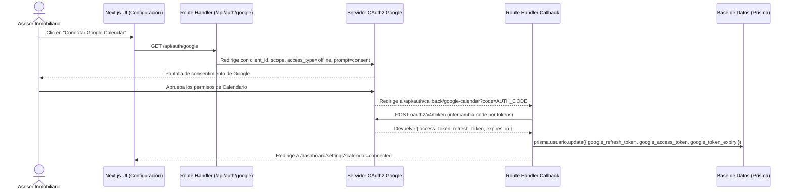

# Integración con Google Calendar — CRM Inmobiliario ISO

Este documento detalla la arquitectura, configuración y especificación técnica para sincronizar citas y visitas inmobiliarias con Google Calendar utilizando OAuth2 y Server Actions en Next.js 14.

---

## 1. Variables de Entorno Necesarias

En el archivo `.env` se deben registrar las credenciales de la aplicación configurada en [Google Cloud Console](https://console.cloud.google.com/):

```env
# Google OAuth2 Credentials
GOOGLE_CLIENT_ID="tu-google-client-id.apps.googleusercontent.com"
GOOGLE_CLIENT_SECRET="GOCSPX-tu-google-client-secret"
GOOGLE_REDIRECT_URI="http://localhost:3000/api/auth/callback/google-calendar"

# Scopes requeridos
# https://www.googleapis.com/auth/calendar.events
```

> **Nota de Seguridad:** En producción, `GOOGLE_REDIRECT_URI` debe apuntar al dominio HTTPS del sistema (por ejemplo, `https://crm.proptech.mx/api/auth/callback/google-calendar`).

---

## 2. Flujo Paso a Paso de OAuth2

### A. Modificación del Modelo Prisma (`Usuario`)
Para persistir los tokens de Google sin requerir que el usuario re-autorice en cada sesión, se agregan los siguientes campos al modelo `Usuario` en `prisma/schema.prisma`:

```prisma
model Usuario {
  id_usuario            String    @id @default(uuid())
  id_tenant             Int
  email                 String    @unique
  nombre                String?
  // ... otros campos existentes

  // Campos para sincronización con Google Calendar
  google_refresh_token  String?   @db.Text
  google_access_token   String?   @db.Text
  google_token_expiry   DateTime?
  google_calendar_id    String?   @default("primary")

  // ... relaciones existentes
}
```

### B. Diagrama de Secuencia del Flujo OAuth2



### C. Pasos del Flujo:
1. **Inicio de Vinculación:** Desde la sección de configuración del asesor (`/dashboard/settings`), se provee un botón "Vincular Google Calendar".
2. **Generación de URL de Autorización:** El servidor genera el enlace con los parámetros clave:
   - `access_type=offline` (fundamental para recibir `refresh_token`).
   - `prompt=consent` (fuerza la entrega del `refresh_token` incluso si ya había sido autorizado con anterioridad).
   - `scope=https://www.googleapis.com/auth/calendar.events`.
   - `state` con CSRF token y el `id_usuario`.
3. **Recepción del Código de Autorización:** Google redirige a `GOOGLE_REDIRECT_URI` con el parámetro `code`.
4. **Intercambio de Tokens y Persistencia:** El callback intercambia `code` por `access_token` y `refresh_token` con la API de Google, y actualiza el registro del `Usuario` en Prisma bajo el `id_tenant` verificado.

---

## 3. Pseudocódigo de la Server Action: Agendar Visita Programada

Esta Server Action se ejecuta cuando se agenda una nueva visita entre un cliente y una propiedad en el CRM:

```typescript
"use server"

import { revalidatePath } from "next/cache"
import { prisma } from "@/lib/prisma"
import { verifySession } from "@/lib/auth"
import { google } from "googleapis"

interface AgendarVisitaInput {
  idCliente: number
  idPropiedad: number
  fechaInicio: Date
  fechaFin: Date
  notas?: string
}

export async function agendarVisitaProgramada(input: AgendarVisitaInput) {
  try {
    // 1. Validar sesión y Multi-tenancy
    const session = await verifySession()
    const { userId, tenantId } = session

    // 2. Obtener asesor y sus tokens de Google
    const usuario = await prisma.usuario.findFirst({
      where: {
        id_usuario: userId,
        id_tenant: tenantId,
      },
      include: {
        asesor: true,
      },
    })

    if (!usuario?.google_refresh_token) {
      return { 
        error: "El asesor no tiene conectada su cuenta de Google Calendar" 
      }
    }

    // 3. Obtener información de Cliente y Propiedad para el evento
    const cliente = await prisma.cliente.findFirst({
      where: { id_cliente: input.idCliente, id_tenant: tenantId }
    })
    const propiedad = await prisma.propiedad.findFirst({
      where: { id_propiedad: input.idPropiedad, id_tenant: tenantId }
    })

    if (!cliente || !propiedad) {
      return { error: "Cliente o propiedad no encontrados" }
    }

    // 4. Configurar cliente OAuth2 de Google
    const oauth2Client = new google.auth.OAuth2(
      process.env.GOOGLE_CLIENT_ID,
      process.env.GOOGLE_CLIENT_SECRET,
      process.env.GOOGLE_REDIRECT_URI
    )

    oauth2Client.setCredentials({
      refresh_token: usuario.google_refresh_token,
      access_token: usuario.google_access_token ?? undefined,
    })

    // Si el access_token expiró, googleapis lo refresca automáticamente usando el refresh_token
    const calendar = google.calendar({ version: "v3", auth: oauth2Client })

    // 5. Construir y enviar el evento a Google Calendar
    const eventResponse = await calendar.events.insert({
      calendarId: usuario.google_calendar_id || "primary",
      sendUpdates: "all", // Envía invitación por correo al cliente si tiene email
      requestBody: {
        summary: `Visita Inmobiliaria: ${propiedad.titulo}`,
        description: `Visita programada con el cliente ${cliente.nombre} ${cliente.apellido_paterno}.\n` +
                     `Teléfono: ${cliente.telefono_principal || 'N/A'}\n` +
                     `Notas: ${input.notas || 'Sin notas adicionales'}`,
        location: `${propiedad.ciudad || ''}, México`,
        start: {
          dateTime: input.fechaInicio.toISOString(),
          timeZone: "America/Mexico_City",
        },
        end: {
          dateTime: input.fechaFin.toISOString(),
          timeZone: "America/Mexico_City",
        },
        attendees: cliente.correo ? [{ email: cliente.correo }] : [],
        reminders: {
          useDefault: false,
          overrides: [
            { method: "popup", minutes: 30 },
            { method: "email", minutes: 1440 }, // 1 día antes
          ],
        },
      },
    })

    const googleEventId = eventResponse.data.id

    // 6. Registrar la actividad en la base de datos (Prisma)
    await prisma.$transaction([
      prisma.clienteActividad.create({
        data: {
          id_cliente: cliente.id_cliente,
          id_asesor: usuario.id_asesor,
          tipo: "Visita Programada",
          descripcion: `Visita agendada para propiedad #${propiedad.id_propiedad} (Google Event ID: ${googleEventId})`,
          fecha: input.fechaInicio,
        },
      }),
      prisma.propiedadActividad.create({
        data: {
          id_propiedad: propiedad.id_propiedad,
          id_asesor: usuario.id_asesor,
          tipo: "Visita Programada",
          descripcion: `Visita con cliente ${cliente.nombre} (Google Event ID: ${googleEventId})`,
          fecha: input.fechaInicio,
        },
      }),
    ])

    revalidatePath("/dashboard/clients")
    revalidatePath("/dashboard/properties")
    revalidatePath("/dashboard/calendar")

    return {
      success: true,
      data: {
        googleEventId,
        htmlLink: eventResponse.data.htmlLink,
      },
    }
  } catch (error) {
    console.error("Error al crear evento en Google Calendar:", error)
    return {
      error: error instanceof Error ? error.message : "Error inesperado al agendar la visita",
    }
  }
}
```
